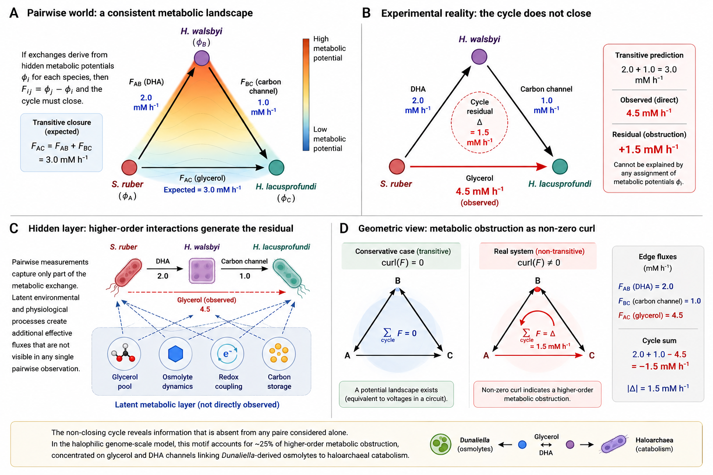
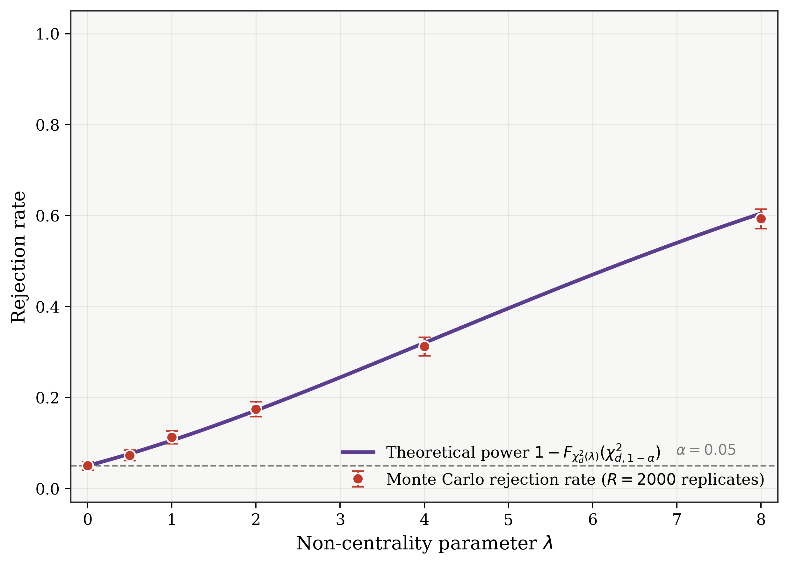
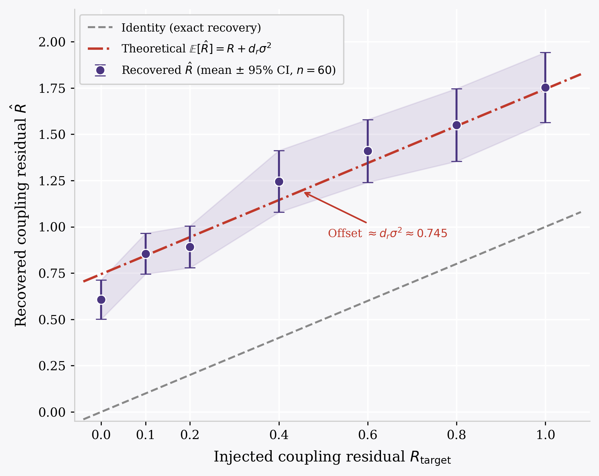
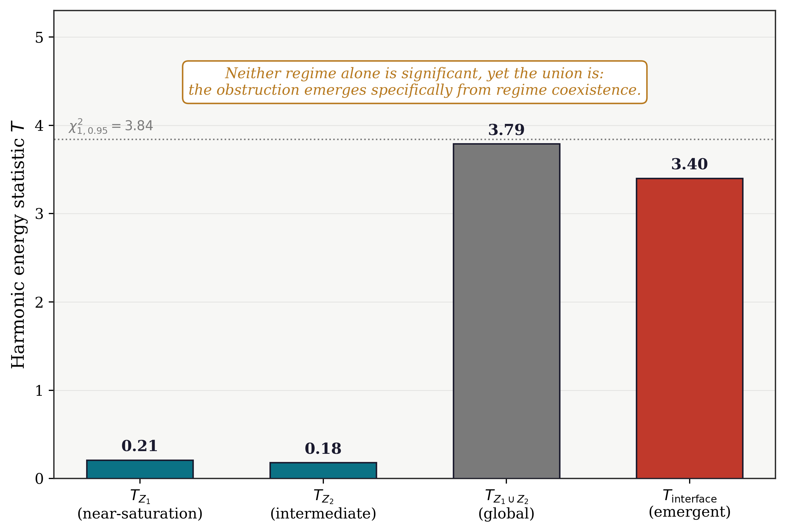
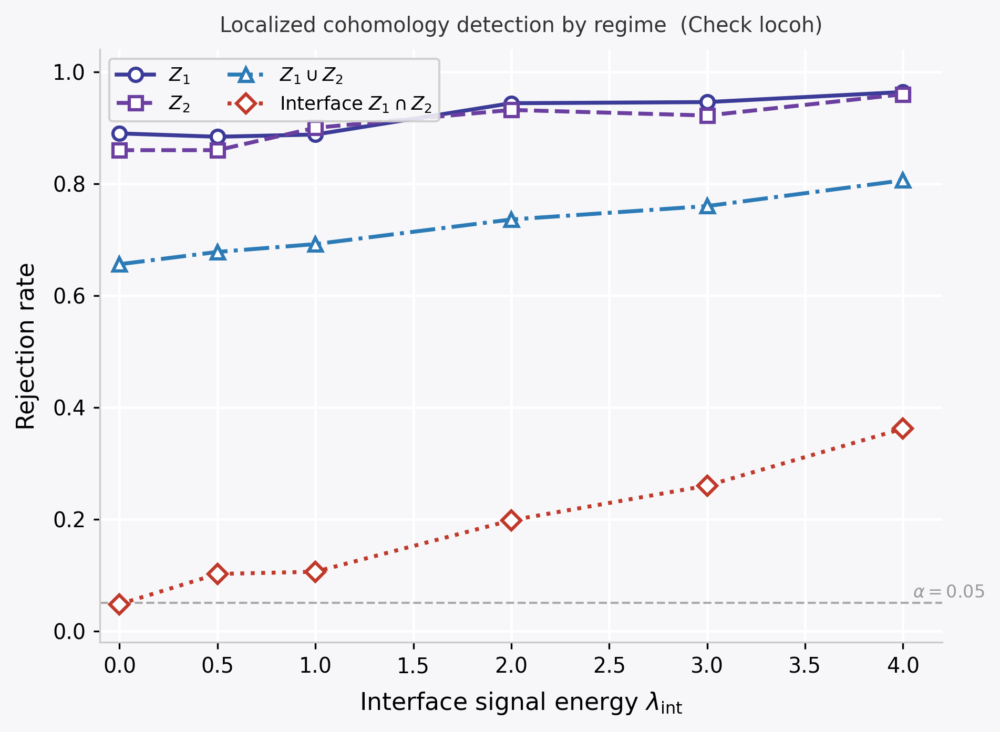
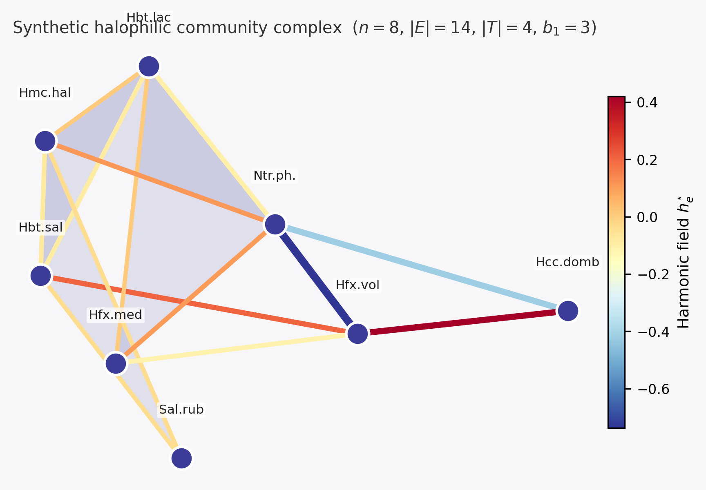

# Higher-Order Metabolic Obstructions in Microbial Communities: A Sheaf–Hodge Framework

> **Alex Centeno-Mejía** — Doctorado en Modelamiento Matemático Aplicado & Genomic Ecology Microbial Applied Laboratory, Universidad Católica del Maule, Talca, Chile.
>
> *IEEE/ACM Transactions on Computational Biology and Bioinformatics* (under review)

---

## Overview

Microbial communities are commonly described through pairwise metabolic interactions, implicitly assuming that community-level behavior can be reconstructed from local measurements alone. This work extends a sheaf-theoretic framework from **detection** to **interpretation, localization, prediction, and experimental design** of higher-order metabolic obstructions — situations in which individually consistent pairwise interactions fail to assemble into a globally coherent community description.

<p align="center">
  
  <br/>
  <em>Fig. 1 — Conceptual overview. Panel A: a consistent pairwise landscape. Panel B: experimental reality — the cycle does not close. Panel C: hidden higher-order interactions generate the residual. Panel D: geometric view of metabolic obstruction as non-zero curl.</em>
</p>

---

## Key Results

| Module | What it does | Key figure |
|--------|-------------|------------|
| **Internal Hom Sheaf** $\mathcal{S\!hHom}(\mathcal{F},\mathcal{F})$ | Distinguishes changes in *transfer mechanism* from changes in *exchange magnitude* | — |
| **Tensor Product** $\mathcal{F}_1\otimes\mathcal{F}_2$ | Detects genuine coupling between metabolic channels | Fig. 2 |
| **Localized Cohomology** $H^k_Z$ | Localizes higher-order inconsistencies across environmental regimes via Mayer–Vietoris | Fig. 4 |
| **Cohomological Prediction** | Predicts unobserved community configurations with rigorous uncertainty quantification | — |
| **D-Harmonic Greedy Design** | Identifies most informative co-culture experiments under limited budgets | Fig. S5 |

---

## Figures

### Main Paper

<table>
<tr>
<td align="center">
<br/>
<b>Fig. 2</b> — Power curve for the harmonic energy test (<em>d</em> = 4, α = 0.05, <em>R</em> = 2000 replicates).
</td>
<td align="center">
<br/>
<b>Fig. 3</b> — Künneth coupling decomposition validation. Recovered R̂ vs injected R<sub>target</sub>, showing E[R̂] = R + d<sub>r</sub>σ².
</td>
</tr>
<tr>
<td align="center" colspan="2">
<br/>
<b>Fig. 4</b> — Interface emergence: harmonic energy statistics T<sub>Z₁</sub>, T<sub>Z₂</sub>, T<sub>Z₁∪Z₂</sub>, T<sub>interface</sub>. Neither regime alone is significant; the obstruction emerges from regime coexistence.
</td>
</tr>
</table>

### Supplementary Material

<table>
<tr>
<td align="center">
<br/>
<b>Fig. S1</b> — QQ-plot of T under H₀ vs χ²₄ (Check 2). KS p = 0.600.
</td>
<td align="center">
<br/>
<b>Fig. S2</b> — Power curves for d ∈ {2,4,6,8}. Power decreases with d for fixed λ.
</td>
</tr>
<tr>
<td align="center">
<br/>
<b>Fig. S3</b> — Localized cohomology detection rates by regime.
</td>
<td align="center">
<br/>
<b>Fig. S4</b> — Synthetic halophilic community simplicial complex. Edge colors encode the harmonic field h*ₑ.
</td>
</tr>
<tr>
<td align="center" colspan="2">
<br/>
<b>Fig. S5</b> — Greedy D-harmonic design vs random selection. Gap ≈ 2.91 nats at budget exhaustion.
</td>
</tr>
</table>

---

## Repository Structure

```
.
├── README.md
├── figures/                          # All paper and supplementary figures
│   ├── ima1.png                      # Fig. 1 — Conceptual overview
│   ├── fig2_power_curve.png          # Fig. 2 — Power curve
│   ├── fig3_coupling_decomposition.png  # Fig. 3 — Künneth validation
│   ├── fig4_interface_emergence.png  # Fig. 4 — Interface emergence
│   ├── figS1_qqplot.png              # Fig. S1 — QQ-plot
│   ├── figS2_power_multiD.png        # Fig. S2 — Multi-d power curves
│   ├── figS3_locoh_detection.png     # Fig. S3 — Locoh detection
│   ├── figS4_complex.png             # Fig. S4 — Complex visualization
│   └── figS5_greedy_design.png       # Fig. S5 — Greedy design
│
├── notebooks/
│   ├── coupling_decomposition.ipynb  # Künneth coupling decomposition (Fig. 3)
│   └── Real-data_application.ipynb   # Halophilic GSMM application (Fig. 4)
│
├── code/
│   ├── fig2_power_curve.py           # Generates Fig. 2
│   ├── fig3_from_synthetic.py        # Generates Fig. 3 from synthetic data
│   └── supp_figures.py               # Generates all supplementary figures (S1–S5)
│
└── latex/
    ├── NewIEEE.tex                   # Main paper (IEEEtran, 14 pages)
    └── SupplementaryMaterial.tex     # Extended supplementary (5 sections)
```

---

## Mathematical Framework

The framework is built on three interlocking constructions over a simplicial complex $\mathcal{K}$ representing the community interaction network:

**1. Metabolic Interaction Sheaf** $\mathcal{F}$

Assigns a stalk $\mathcal{F}(e) = \mathbb{R}^m$ of metabolite exchange rates to each directed species pair $e$. The **harmonic component** $h^* \in \ker\Delta_1$ (first Betti group of $\mathcal{K}$) certifies that exchange rates cannot be explained by any assignment of per-species metabolic potentials — a *higher-order obstruction*.

**2. Hodge Laplacian**

$$\Delta_1 = \delta_0 \Sigma^{-1} \delta_0^\top + \delta_1^\top \delta_1$$

where $\delta_0, \delta_1$ are the coboundary operators. The test statistic $T = \hat{h}^\top \Sigma^{-1} \hat{h} \sim \chi^2_d(\lambda)$ under additive Gaussian noise, enabling **exact finite-sample inference**.

**3. Extended Modules**

- $\mathcal{S\!hHom}(\mathcal{F},\mathcal{F})$: operator-valued sheaf encoding metabolic transfer mechanisms
- $\mathcal{F}_1 \otimes \mathcal{F}_2$: tensor product for cross-channel coupling (Künneth decomposition)
- $H^k_Z(\mathcal{K};\mathcal{F})$: localized cohomology for regime-specific obstruction attribution

---

## Reproducing the Figures

All figures can be reproduced with NumPy/SciPy/NetworkX/Matplotlib (no specialized topology libraries required).

```bash
# Clone the repository
git clone https://github.com/AlCenme1/HIGHER-ORDER-METABOLIC-OBSTRUCTIONS-IN-MICROBIAL-COMMUNITIES-SHEAF--HODGE-FRAMEWORK.git
cd HIGHER-ORDER-METABOLIC-OBSTRUCTIONS-IN-MICROBIAL-COMMUNITIES-SHEAF--HODGE-FRAMEWORK

# Install dependencies
pip install numpy scipy networkx matplotlib

# Fig. 2 — Power curve
python code/fig2_power_curve.py

# Fig. 3 — Künneth validation (from synthetic data)
python code/fig3_from_synthetic.py

# Figs. S1–S5 — All supplementary figures
python code/supp_figures.py
```

Notebooks can be run in Jupyter:

```bash
pip install jupyter
jupyter notebook notebooks/
```

---

## Validation Checks

The framework includes three mandatory numerical checks before application to real data (Section 9 of the main paper):

| Check | What it verifies | Tool |
|-------|-----------------|------|
| **Check 1** — Exact recovery | $\|\hat{h} - h^*\| < 10^{-8}$ in noiseless limit | `fig3_from_synthetic.py` |
| **Check 2** — Calibration | $T \sim \chi^2_d$ under $H_0$ (KS test + QQ-plot) | Fig. S1 |
| **Check 3** — Power | Empirical rejection rate tracks theoretical $1 - F_{\chi^2_d(\lambda)}(\chi^2_{d,0.95})$ | Fig. 2 |

---

## Citation

```bibtex
@article{centeno2026higher,
  title     = {Higher-Order Metabolic Obstructions in Microbial Communities:
               An Extended Sheaf--Hodge Framework for Mechanism, Coupling, and Prediction},
  author    = {Centeno-Mej\'{\i}a, Alex},
  journal   = {IEEE/ACM Transactions on Computational Biology and Bioinformatics},
  year      = {2026},
  note      = {Under review}
}
```

---

## License

Code released under the [MIT License](LICENSE). Figures and manuscript text © 2026 Alex Centeno-Mejía, all rights reserved pending journal publication.

---

<p align="center">
  <em>Universidad Católica del Maule · Doctorado en Modelamiento Matemático Aplicado · GEMA</em>
</p>
